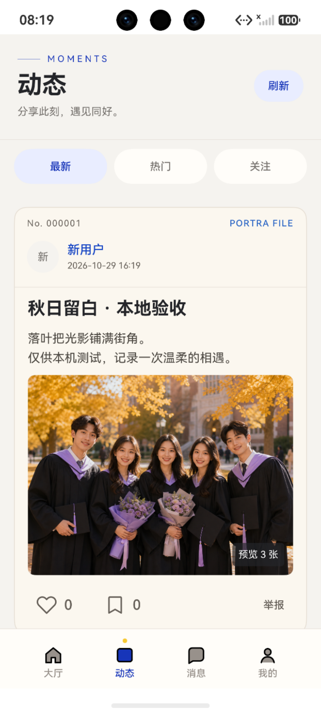
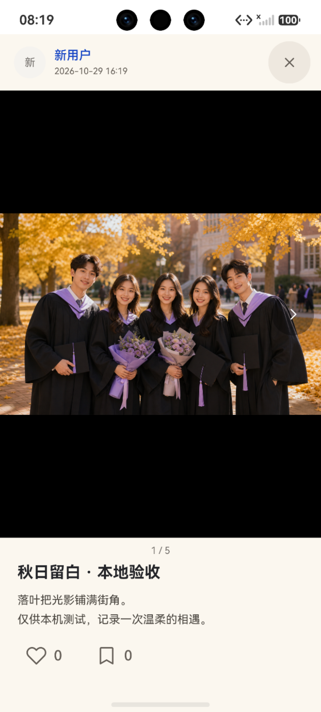
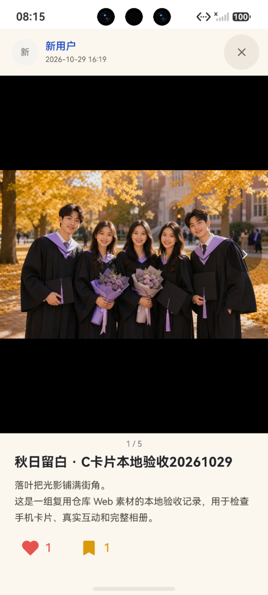
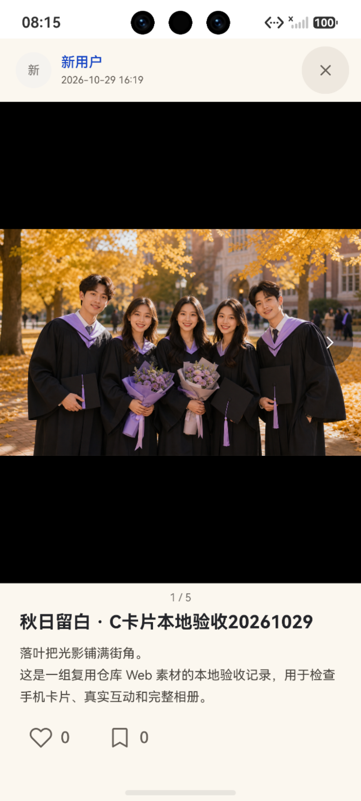

# 动态卡片、详情互动与举报身份：当前验收

2026-10-29。从d145f49继续，发现公共1b14687/b42b2a8后本地快进复用；38远端文件与C修改重叠0。PR25已于北京时间18:07:56被外部合并，本轮未执行合并、不改main，后续只交Draft。旧整页黑色预览见[历史](preview-history.md)，当前以下为准。

卡片保留Web米白、编号、蓝色作者、4:3封面，减弱粗蓝边/印章/阴影。头像昵称整行48vp，标题/图片一次点击进入既有MomentDetail NavDestination，不用bindSheet；没有“查看详情”“查看作者主页”“约拍记录”及上下张文字按钮。只有图片区域黑色，ImageFit.Contain等比完整显示，其他页面区域米白；中央两侧小箭头，48vp触摸。

点赞/收藏仅图标和真实计数，服务器确认后红/金实心，取消灰色空心。无LoadingProgress、处理中标题、透明度加载效果或按下状态动效；请求中仍防重复写，不假成功。详情收藏与Feed共用C MomentFavoriteWrite，真实ApiService PUT/DELETE，不新增网络。共享写屏障与按会话/对象记录的unknown，超时先GET核实、不盲重发；旧账号success/catch/finally不能改新视图。完整响应只把三张预览写回Feed，详情仍是完整5张。

修复返回后二次点图的导航锁，以及失败点赞核实残留target造成的隐藏锁，均RED→GREEN并独立审查闭环。举报身份改为独立listRequestKey.identity，currentSession/cancelCurrentSession只影响本实例，旧视图/身份响应有保护；真实失败仍提示重试，不压掉错误。

修改：C moments目录的MomentCard、MomentDetailPanel、MomentFeedModels、MomentInteractionBindings、MomentInteractions；新增MomentActionButton、MomentAuthor、MomentFavoriteWrite及c_moment_*资源；C页面MomentFeedPage、NotificationMomentPage。测试moment-feed-behavior、moment-interactions、user-system（真实收藏方法断言跟随C helper，未删除要求）。公共/B/D/Web/后端没有新增手工改动。三份交付文档与本证据更新。

## 实际命令和结果

- DEVECO_SDK_HOME为现有SDK，DevEco node --test harmony/tests/moment-feed-behavior.test.cjs harmony/tests/moment-interactions.test.cjs harmony/tests/moment-feed.test.cjs harmony/tests/notification-moment-binding.test.cjs：64/64，exit0。
- 原d145阶段全套243/243 exit0；加入身份2用例、接新公共代码后，在harmony展开tests/*.test.cjs执行node --test：245/240pass/5fail/0skip/TODO，exit1。5项均为未改动auth.test.cjs，见[维护者交接](../../proposals/shared-auth-regressions/README.md)。不能宣称全套通过，也不直接等同5个产品缺陷。
- 进程PORTRA_ENVIRONMENT=dev、PORTRA_BASE_URL=http://127.0.0.1:18090、NODE_HOME/DEVECO_SDK_HOME为现有安装；harmony执行hvigorw.bat assembleHap --no-daemon -p product=dev：exit0，21.306秒。unsigned SHA256：87424F5F9AA09D596F71D7A44D766767232B7562BC5F1A2CFB5CD529840BD8CE。不是签名发布/团队联调包。
- 早期新收藏helper构建因ArkTS抛错类型exit1，修复后通过。点图返回与核实隐藏锁、身份默认key均先失败再通过。初次公开依赖同步被自动审批误认PR合并而拒绝；只读证明祖先关系及重叠0后获准执行同一本地快进，未绕过或执行GitHub合并。

## 真机型模拟器与服务器

Mate90Pro API26/Harmony7.0.0.107/1280×2832，hdc install -r、aa start exit0。原Portra_C_API26已停止。Java42192原隔离服务一直存活，早期“后端退出”判断不准确，连接通过恢复反向18090转发解决；尝试新夹具未替换服务。原进程部署源码SHA不可追溯，不宣称新PNVS后端已验收。

原隔离H2 portra_c_engagement_recovery_20261029，用户1普通CUSTOMER、作者2普通用户、动态1。当前包列表false/0→true/1，点图详情读同状态→两项分别取消false/0，独立普通HTTP GET断言；前一C包另有详情开启→列表取消。[服务端读回](server-observations.json)按阶段保留，[包与命令](verification.json)。仅本地测试内容，无管理员/正式内容操作。

实际关闭再一次点图重开通过；小箭头到2/5、头像与昵称分别进作者2主页通过；返回后、刷新及真实系统Home/恢复后举报入口正常、无身份读取失败。UI树见report-refresh、report-foreground、feed-return、author-avatar、author-nickname。Node只证明逻辑，未当设备证据。

最终预览由普通作者正常PUT把本轮自建长验收标题正文缩短，仍标“本地验收/仅供本机测试”，五张素材与互动状态不变。

仍待：公共认证5项回归核定；头像DTO仅avatarFileId，沿用B昵称头像回退、不造URL；其他屏幕/大字体/过渡动画未单独验收。仅模拟器，本地环境不代表团队外部、合法后台、发布签名验收，不宣称完整C发布完成。
