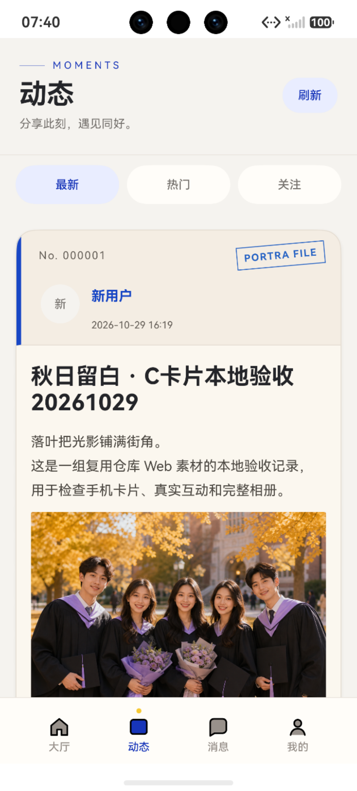
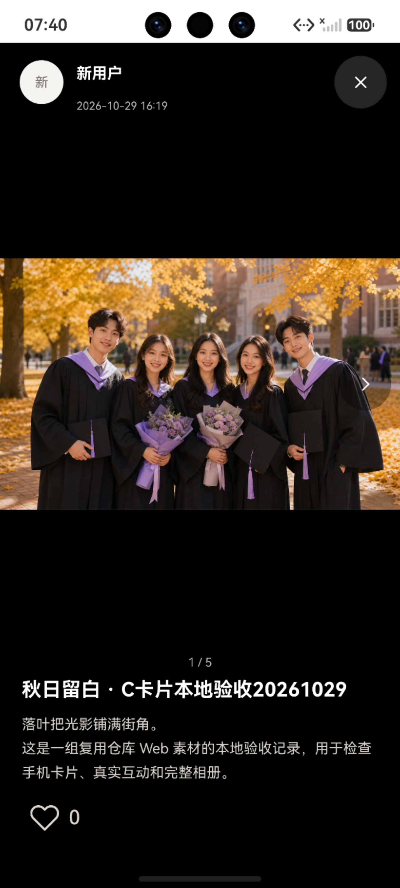

# 动态卡片与全屏图片预览（待用户审阅）

2026-10-29。C独立分支基线d145f491；仅C代码及资源，未改公共、B/D、Web/后端或共享配置。按用户要求构建安装后先停在模拟器供审阅，不将本轮标为完整验收。

Web参考：frontend/src/pages/feed/components/MomentCard.jsx、feed.css手机断点。米白纸张、蓝边、六位编号、PORTRA FILE、4:3封面，爱心/书签只显示图标与真实计数，选中红/金、取消灰色空心。保留可选回调和默认值供B复用。收藏完整响应经既有feedPreview归一为三张，完整相册仍只来自GET /moments/{id}。

新增C MomentAuthor读取既有公开资料昵称；DTO只有avatarFileId、没有可用图片地址，头像沿用现B公开主页的昵称头像回退，不编造URL。头像与昵称都有作者回调。图片/标题进入既有MomentDetail NavDestination，不用bindSheet、弹窗或新路由；C NotificationMomentPage接已有PublicProfile作者目标。详情黑底ImageFit.Contain，空余黑色，中央两侧白色小箭头，48vp触摸；关闭仅图标。

实际验证：
- node --test harmony/tests/moment-feed-behavior.test.cjs：新增收藏预览用例先exit1（5 !== 3），修复后34/34 exit0。
- 新增全页路由用例先exit1（未push），接入后相关37/37 exit0。旧详情GET/隐藏/404用例保留为结果核实行为，不冒充真实导航。
- harmony目录，DEVECO_SDK_HOME设本机现有SDK，PowerShell展开tests/*.test.cjs，DevEco node --test：237/237，0fail/skip/TODO，exit0。
- PORTRA_BASE_URL=http://127.0.0.1:18090，hvigorw.bat assembleHap --no-daemon -p product=dev：首次exit1（显式导航参数类型及组件key命名冲突），修复后exit0 / 24.210秒。
- HAP SHA256：6A0A26836BB3EA07E611673D9D9AC210B3E10971F47E0B2E5D272A47B54D8352；unsigned开发包。hdc install -r、aa start均exit0。
- 当前真实设备为Mate 90 Pro API26 / Harmony7.0.0.107、1280×2832；原Portra_C_API26已停止，故最初该实例UI命令失败，未冒充成功。HDC反向18090转发已恢复。原隔离Java42192/portra_c_engagement_recovery_20261029仍存活且普通HTTP读回原五图动态1，未成功替换后端。尝试新夹具启动未持续占用端口，未创建管理员。
- 当前模拟器普通用户1通过随机短信正常登录；真实卡片点击封面后进入独立全屏动态1，读取5图并显示1/5、真实昵称“新用户”、头像回退和小箭头，无底部弹层/文字详情入口。截图及UI树如下。

待用户先审阅外观。此预览尚未完成本轮模拟器点赞/收藏开→关、颜色像素、两侧箭头切图、头像与昵称逐一真实跳转及其他屏幕尺寸验收；不能据Node或旧证据声称这些已验收。动态详情本轮仍仅点赞，收藏保留Feed既有实现。自然放大过渡动画尚未单独验收。团队环境/发布签名仍未验证。原Draft PR25保持，未提交/推送本轮预览、不合并。
