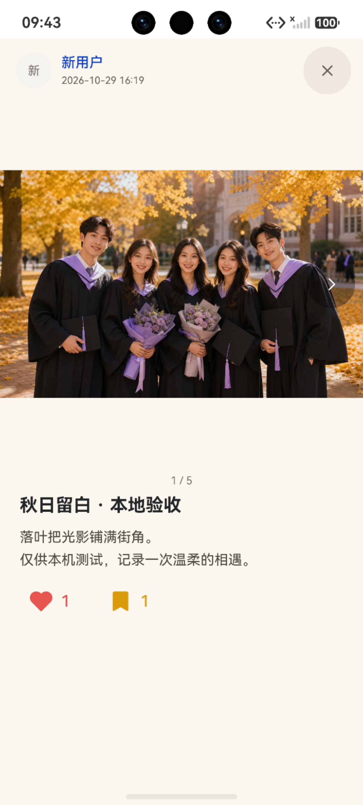
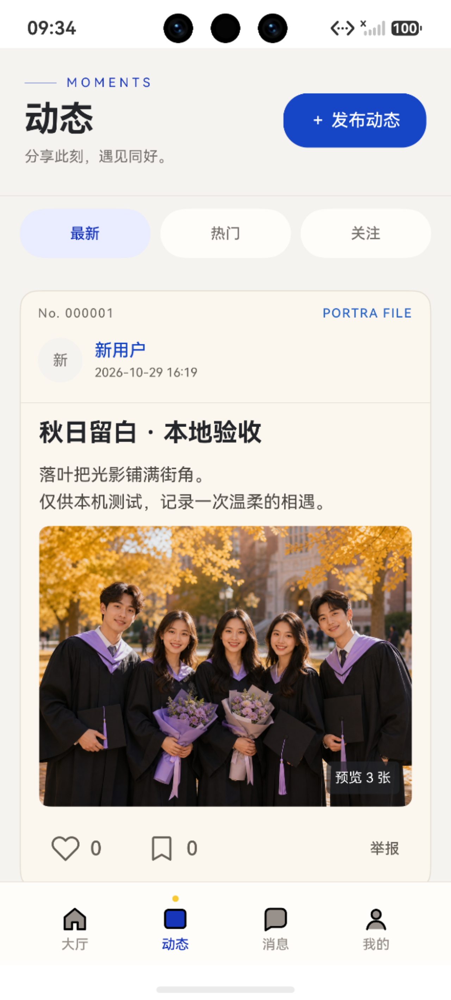
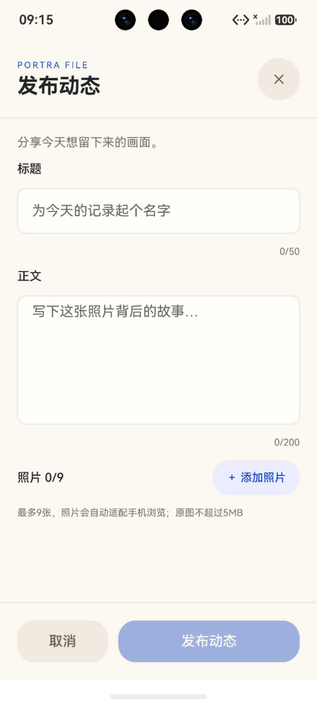

# 同背景补齐、固定相册基线与动态发布

本轮交付PR26，唯一base integration/harmony-v1。用户先要求本机预览，随后明确“改完检查好马上推送”“合并合并，确认没问题赶紧合并”；此前未提交，本次按最新授权完成检查后交付，不操作main。

详情按等宽显示后的最高图片固定整组相册高度，短图居中以页面同色#FBF7EF补齐；文字/点赞/收藏同组切图不移动，其他区域继续米白。原始尺寸一次收集，旧相册回调/互动更新不会改新基线；不支持的图片来源继续走既有InlineImagePolicy，失败图片释放尺寸等待。设备两张不同高宽照片标题位置1741=1741，最后一版只将补齐色由黑改为页面同色，已实际安装截图。

广场删除刷新键，采用原生Refresh和真实GET；重复手势合一，异常/隐藏结束指示，旧finally不停止新刷新，举报草稿未关闭时禁刷新。右上仅116vp×44vp发布按钮并留16vp间距。真实HDC下拉：普通作者正常PUT给本轮本地动态1加验收标记→原生下拉出现新文→普通PUT恢复→再次下拉恢复原文；非Node手动生命周期、非轮询。

动态发布采用Web风格手机表单，标题50、正文200、1—9图。用户已明确获维护者授权2文件：ApiModels的CreateMomentPayload；ApiService的createMoment(payload,key?)/cancelMomentCreate(key?)，复用原HttpClient。C Controller/API binding/Panel负责真实会话、提交快照、实例取消、旧账号/响应/finally保护及unknown不盲重发；同账号共享Attempts订阅，旧请求settle可更新新页，关闭退订。原生PhotoViewPicker读取图片并由ImageKit适配≤160KiB/图、总≤1.5MiB，单次创建响应含首图重复约≤2.2MiB。发布页按真实系统安全区+8vp留白，设备captionY242、按钮底2664，没有压状态栏。图库选图/压缩及设备POST创建仍未执行；不能把表单截图或Node当完整发布联调。

新增/修改：C MomentDetailPanel、MomentFeedPage；新MomentPublishController、MomentPublishApiBinding、MomentPublishPanel、MomentPublishLimits；已授权公共ApiModels/ApiService。回归moment-detail-layout、moment-publish、moment-feed-behavior。其余公共认证/HttpClient/全局导航/B/D/Web/后端未手改。独立审查发现容量与共享状态两项，均补RED→GREEN并复核；设备发现Builder旧图复用，改成明确图片身份并验证，后按用户最新固定基线调整。

实际命令：DEVECO_SDK_HOME设现有SDK，harmony展开tests/*.test.cjs，DevEco node --test：260项255过、5fail、0skip/TODO、exit1。独立git archive origin/integration/harmony-v1提取只读基线，node --test auth.test.cjs：10项5过5fail，失败名称与当前完全相同，未改测试掩盖。公共认证精确交接沿用C-SHARED-09。本轮未新增回归，不声称全套通过。

PORTRA_ENVIRONMENT=dev、PORTRA_BASE_URL=http://127.0.0.1:18090、NODE_HOME/DEVECO_SDK_HOME现有安装；hvigorw.bat assembleHap --no-daemon -p product=dev：exit0/15.720秒；unsigned SHA256 83F6B5B10040D04645C7851004D5D4C8D056678ED7650E19777827675CDD58C6。hdc install -r与aa start均exit0。仅授权隔离H2/模拟器，不是团队外部或签名验收。图片同背景为最终包；固定几何及发布安全区截图为对应前序包的同逻辑证据，具体按UI生成时间区分。

剩余：既有5认证回归；设备正常选图/POST验收；未分页累计Feed响应大小与缩略图依赖。没有管理员页面、假成功、轮询、自动重复POST、正式内容操作。
